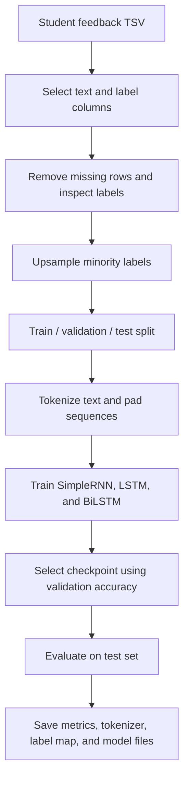

# Aspect-Based Sentiment Analysis of Student Feedback using RNN

> **Project status:** The current published implementation is a recurrent-neural-network pipeline for **three-class, overall sentiment classification** of feedback text (`negative`, `neutral`, and `positive`). The code does not yet appear to extract distinct aspects (such as teaching, course materials, assessment, or facilities) and predict a separate sentiment for each aspect. The title describes the intended direction; see [Scope and current limitations](#scope-and-current-limitations).

This project explores how recurrent neural networks can classify student feedback and support the analysis of comments for academic improvement. It compares SimpleRNN, LSTM, and Bidirectional LSTM (BiLSTM) models, records validation scores and training time, evaluates a selected model, and saves model artifacts for reuse.

## Contents

- [Project objectives](#project-objectives)
- [Current workflow](#current-workflow)
- [Models](#models)
- [Recorded results](#recorded-results)
- [Repository structure](#repository-structure)
- [Getting started](#getting-started)
- [Running inference](#running-inference)
- [Data format and privacy](#data-format-and-privacy)
- [Scope and current limitations](#scope-and-current-limitations)
- [Possible next steps](#possible-next-steps)
- [Acknowledgements](#acknowledgements)

## Project objectives

The project aims to:

1. Prepare text feedback for neural text classification.
2. Compare SimpleRNN, LSTM, and BiLSTM architectures under a shared preprocessing and training pipeline.
3. Use validation performance to select a model checkpoint.
4. report test-set metrics and per-class precision, recall, and F1-score.
5. Preserve the tokenizer, label mapping, trained weights, and sample predictions as project artifacts.

## Current workflow



**Evaluation note:** the current script performs upsampling **before** the train/validation/test split. This can place duplicates of the same original review in different partitions and make evaluation less reliable. For a defensible benchmark, split the original examples first, then resample only the training partition. The reported scores below should therefore be treated as preliminary until the evaluation is rerun with that correction.

## Models

The Python script defines and compares three architectures:

| Model | Main architecture in the current script |
|---|---|
| SimpleRNN | 100-dimensional embedding → SimpleRNN (64 units) → dense layer → dropout → softmax classifier |
| LSTM | 100-dimensional embedding → LSTM (128 units) → dense layer → dropout → softmax classifier |
| BiLSTM | 100-dimensional embedding → bidirectional LSTM (128 units per direction) → dense layer → dropout → softmax classifier |

Shared settings in the code include a maximum vocabulary of 20,000 tokens, sequence length of 30, Adam with a learning rate of `0.001`, categorical cross-entropy, L2 regularization, dropout, early stopping, and model checkpointing. Training is configured for up to six epochs with a batch size of 256.

## Recorded results

The repository's saved artifacts report the following validation accuracies and test-set results:

### Validation comparison

| Model | Validation accuracy | Validation loss | Recorded training time |
|---|---:|---:|---:|
| SimpleRNN | 59.65% | 0.7975 | ~1 min 25 sec |
| LSTM | 56.97% | 0.8408 | ~1 min 56 sec |
| BiLSTM | 58.68% | 0.8074 | ~2 min 38 sec |

### Saved test report

| Metric | Recorded value |
|---|---:|
| Accuracy | 59.99% |
| Macro precision | 63.62% |
| Macro recall | 59.99% |
| Macro F1-score | 60.33% |

Per-class F1 scores from the saved report are approximately 0.637 for `negative`, 0.565 for `neutral`, and 0.608 for `positive`.

> **Interpret these metrics cautiously.** The saved classification report is an artifact from the current run, not an independently reproduced benchmark. Because resampling happens before data splitting, the test set may contain duplicate reviews that also appear during training. Fix the splitting order and rerun the experiment before using these numbers as final project results or CV achievements.

## Repository structure

```text
.
├── Aspect-Based Sentiment Analysis of Student Feedback using RNN.ipynb
├── Aspect-Based Sentiment Analysis of Student Feedback using RNN.py
├── best_SimpleRNN.h5
├── best_LSTM.h5
├── best_BiLSTM.h5
├── best_model_project.h5
├── tokenizer.json
├── label_map.json
├── model_val_scores.json
├── classification_report.json
├── demo_input_output.tsv
├── requirements.txt
└── SUBMISSION_CHECKLIST.txt
```

The trained `.h5` files are saved checkpoints, `tokenizer.json` stores the fitted text tokenizer, `label_map.json` maps output indices to sentiment classes, and the JSON/TSV files contain model metrics and example predictions.

## Getting started

### 1. Clone the repository

```bash
git clone https://github.com/Emon1044/Aspect-Based-Sentiment-Analysis-of-Student-Feedback-using-RNN.git
cd Aspect-Based-Sentiment-Analysis-of-Student-Feedback-using-RNN
```

### 2. Prepare the Python environment

The current `requirements.txt` was generated using `pip freeze` in a hosted notebook environment and contains many unrelated or platform-specific packages. It is not a minimal portable dependency list. Create a clean environment and install the direct dependencies needed by this script, then pin the versions that you successfully test.

```bash
python -m venv .venv
# Windows PowerShell:
.venv\Scripts\Activate.ps1
# macOS/Linux:
# source .venv/bin/activate

python -m pip install --upgrade pip
python -m pip install tensorflow pandas numpy scikit-learn matplotlib seaborn nltk wordcloud psutil jupyter
```

TensorFlow's supported Python versions and installation instructions vary by platform; use a compatible Python/TensorFlow combination for your machine.

### 3. Prepare the input dataset

The training script expects a tab-separated file named:

```text
ReadyToTrain_data_2col_with_subjectivity_final.tsv
```

It currently points to a Google Colab path:

```python
DATA_PATH = "/content/ReadyToTrain_data_2col_with_subjectivity_final.tsv"
```

Change `DATA_PATH` to the real location of your file. The TSV should contain a text column and a three-class sentiment label column. The script attempts to infer the column names, but using explicit and documented column names is safer. The data file itself is not included in this repository, so you must supply an authorized copy before running the training pipeline.

### 4. Run the notebook

Open the notebook with Jupyter or upload it to Google Colab, update `DATA_PATH`, and execute the cells in order. A GPU can reduce training time but is not required for the model definitions.

The exported `.py` file contains notebook/Colab shell-magics (lines beginning with `!`), so it is not a standard Python script that can be run unchanged with `python file.py`. Use the notebook or convert those cells to ordinary Python before executing it from a terminal.

## Running inference

After running the notebook successfully, the selected model and fitted preprocessing objects are available in the notebook session. The script defines a `predict_sentiment()` helper that returns the predicted class and the model's class-probability dictionary:

```python
text = "The instructor explained the topic clearly and answered questions."
predicted_label, probabilities = predict_sentiment(text)

print("Prediction:", predicted_label)
print("Probabilities:", probabilities)
```

The returned probabilities are model outputs, not necessarily calibrated confidence estimates. In the current implementation, the function predicts one overall sentiment label for the full text.

## Data format and privacy

A typical input table is conceptually structured as follows:

| text | sentiment |
|---|---|
| The instructor explained the topic clearly. | positive |
| The assignments were confusing and difficult. | negative |
| The course was acceptable overall. | neutral |

This table is an illustrative schema, not a claim about the included dataset. Do not publish real student feedback containing names, IDs, contact details, or other identifying information. Confirm consent, institutional approval where applicable, and data-sharing rights before putting feedback data in a public repository.

## Scope and current limitations

- **Overall sentiment, not full ABSA:** the current saved label map contains `negative`, `neutral`, and `positive`; no separate aspect extraction or aspect-specific label output is implemented in the visible pipeline.
- **Split before resampling:** upsampling before splitting risks duplicate leakage. Split the original data first and resample only the training data.
- **Short sequence limit:** `MAX_LEN = 30` truncates longer feedback, which may remove useful context.
- **Reproducibility:** the input data file is external and `DATA_PATH` is environment-specific. Model artifacts were saved from a hosted environment; version compatibility may affect loading.
- **Dependency hygiene:** the checked-in requirements file is a full environment freeze and should be reduced to direct, tested dependencies.
- **Class-level performance:** the saved report shows weaker F1 on neutral feedback than negative feedback; evaluate each class rather than relying only on overall accuracy.

## Possible next steps

1. Correct the data split and rerun all three models; report accuracy, macro-F1, per-class F1, and confusion matrix from an untouched test set.
2. For genuine aspect-based sentiment analysis, define aspect categories, label feedback by aspect, implement aspect extraction or aspect-conditioned classification, and report sentiment for each detected aspect.
3. Add a small inference interface or API only after validating the model and its preprocessing artifacts.
4. Replace the environment-wide requirements dump with a minimal, tested dependency file and document dataset provenance.

## Acknowledgements

This repository is an educational NLP / deep-learning project. Dataset authors and sources should be credited in this section once the exact data provenance and sharing terms are documented.
